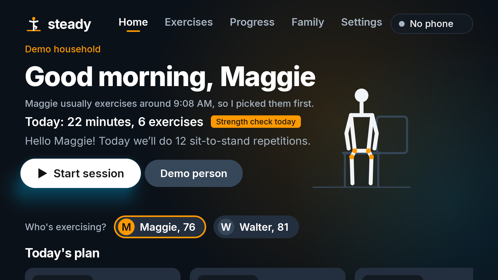
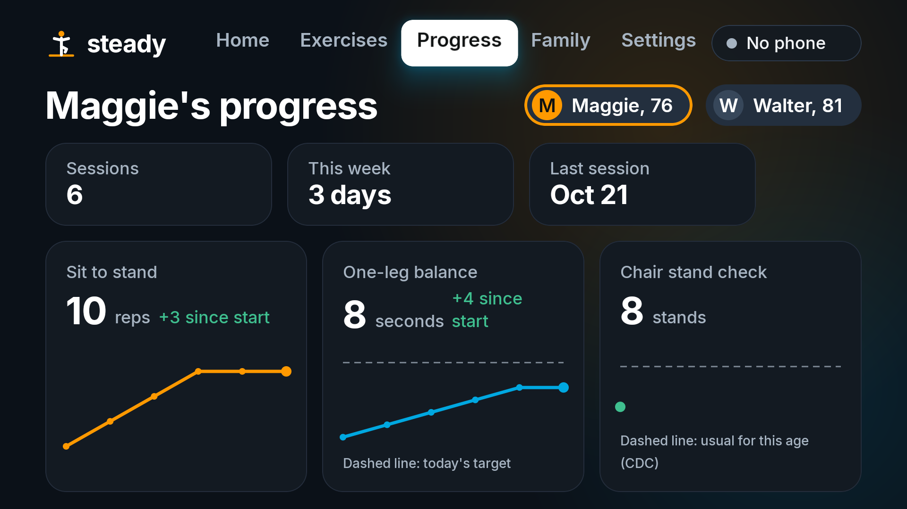
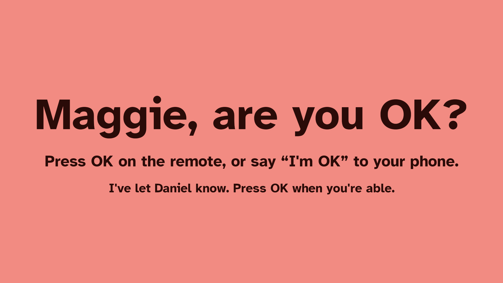
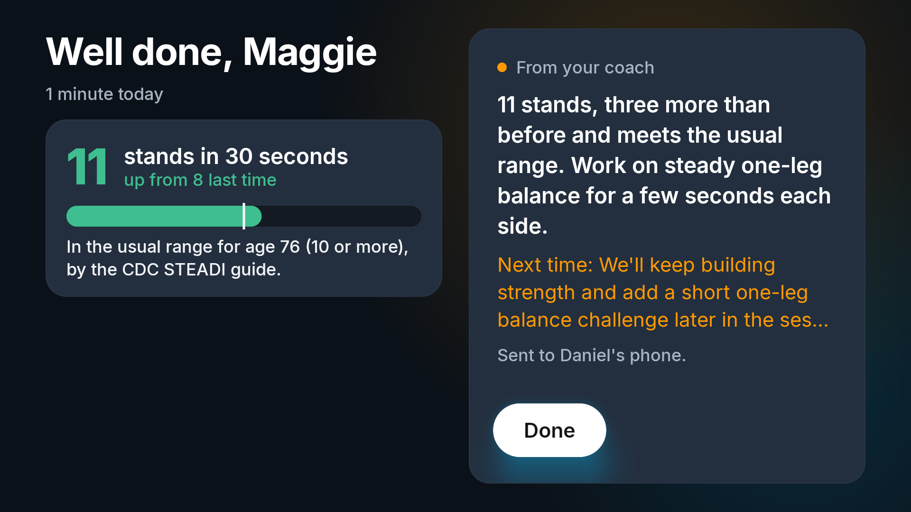
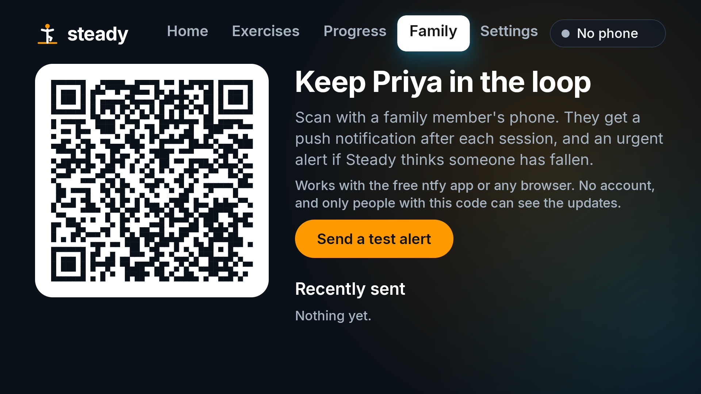
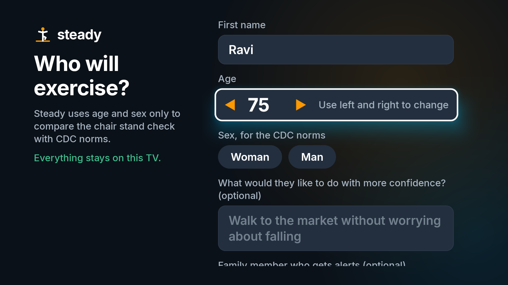
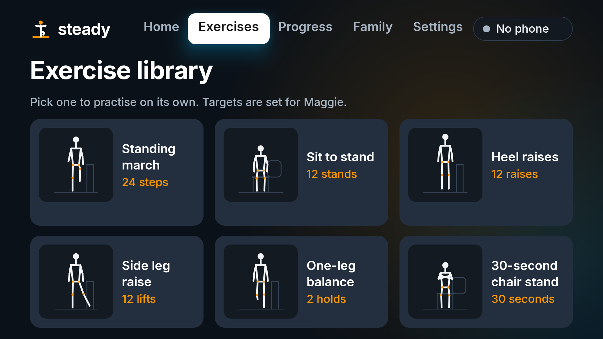
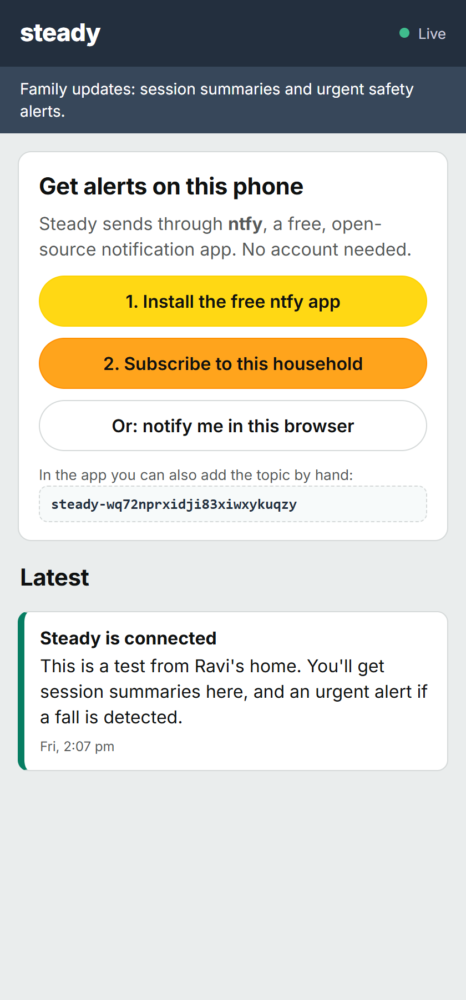
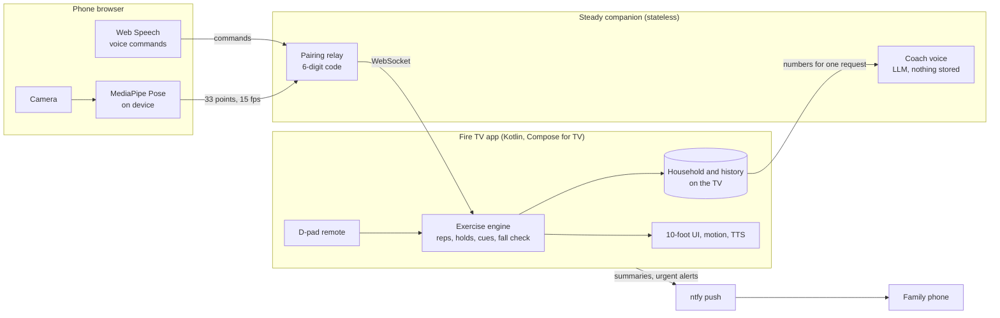

# Steady

**A strength-and-balance coach for Fire TV that helps older adults stay on their feet.**

Steady turns the TV into a patient exercise coach for fall prevention. Your phone, propped against a book, becomes the camera: it tracks your body on the phone itself and sends only 33 joint positions to the TV. The TV shows an animated coach next to a live mirror of you, counts reps, times balance holds, gives one plain-language cue at a time, and checks on you if you go down.

Built for the **Fire TV track** of the Build, Ship, Shape Amazon Developer Hackathon.


## Why

- **1 in 4 adults over 65 falls every year.** That's 14 million people, and falls are the leading cause of injury death in that age group ([CDC](https://www.cdc.gov/falls/data-research/index.html)).
- **The exercises work, but people stop doing them.** The Otago home exercise programme cuts falls by about a third. A year in, only about 37% of people are still doing it ([Age and Ageing review](https://researchnow.flinders.edu.au/en/publications/does-the-otago-exercise-programme-reduce-mortality-and-falls-in-o/)).
- **The problem is doing them alone, not knowing what to do.** People lack feedback, a sense of progress, and someone noticing.
- **The TV is the obvious place for this.** It's the largest, most familiar screen an older adult owns. Most Fire TVs have no camera, but almost everyone has a phone.

## What it does

| | |
|---|---|
| **Phone as camera** | Scan a QR code on the TV. Pose estimation (MediaPipe Pose Landmarker) runs **on the phone**; only joint points travel to the TV. Video never leaves the phone. |
| **Coach + mirror** | An animated coach demonstrates each move beside a mirrored skeleton of you, so "do what I do" works from the sofa. |
| **Counts and corrects** | Rep counting for sit-to-stand, heel raises, marching and side leg raises; a timer and steadiness score for one-leg balance; one form cue at a time ("Stand all the way up", "Lift your knees a little higher"), spoken and shown. |
| **Multi-modal control** | D-pad on the Fire TV remote (OK pauses, ▶ skips, Back finishes), voice on the phone ("pause", "easier", "next", "I'm OK"), big visuals on the TV, in one flow. |
| **Safety check** | If the body goes horizontal and stays there, the session stops, a full-screen "Are you OK?" appears, and after 15 seconds without an answer the family gets an **urgent push notification**. "I'm OK" sends a follow-up. |
| **Clinically grounded progress** | The CDC STEADI 30-second chair stand test, scored against age and sex norms and repeated every two weeks. Progress charts per person. |
| **Your household, on your TV** | First-run setup adds the people who'll exercise (name, age, sex for the norms, a personal goal, a family contact). Their history stays **on the TV**. The home screen predicts who's exercising from the household's own habits ("Walter usually exercises around 6:30 PM"). Plans progress by Otago-style rules; an AI coach explains the plan and writes the end-of-session summary. A demo household is one click away. |
| **Family in the loop** | Real push notifications through [ntfy](https://ntfy.sh) (free, open source, no account): the family scans a QR code on the TV once and gets session summaries and urgent alerts on their phone. |

## Screens

| | |
|---|---|
|  |  |
| **Home.** Predicts who's exercising, explains today's plan. | **Session.** Coach, live mirror, animated counter, one cue at a time. |
|  |  |
| **Progress.** Sit to stand, balance and the chair stand check over time. | **Safety.** No answer, so the family gets an urgent push alert. |
|  |  |
| **Summary.** The AI coach's note and the strength check against the norm. | **Family.** Scan once for push alerts; a test button proves it works. |
|  |  |
| **Setup.** Built for the remote: D-pad age stepper, chips, TV keyboard. | **Exercises.** Practise any move on its own. |



**The family's phone.** Scanning the QR code on the Family tab opens this page: one tap installs or subscribes in the free ntfy app, and updates also appear live here.
<br clear="right">

## How it works



- **`tv/`**: the Fire TV app. Kotlin with Jetpack Compose for TV (Amazon's Fire TV starter stack), minSdk 25 (Fire OS 6+), Leanback banner, D-pad and media-key handling, Android TextToSpeech, OkHttp WebSocket. A Fire TV-native look: squid-ink surfaces, Amazon orange actions, Prime blue focus glow, top navigation, and motion throughout (animated logo, ambient light, spring focus, rep bursts, ring sweeps, confetti, pulse rings, staggered reveals). The exercise engine (`pose/`) and the coach rules (`data/`) are pure Kotlin with JVM tests.
- **`companion/`**: Node + TypeScript, **stateless**: pairs phone and TV by a 6-digit code and relays frames, serves the phone and family pages, and turns plans and sessions into the coach's words. Rate-limited, input-validated, size-capped. The LLM key stays here. Without a key the TV uses its own rule-based coach text.
- **[steady-pose](https://github.com/aditya13504/steady-pose)**: the exercise engine as a standalone MIT library.
- **Demo person**: a synthetic person generated from the coach's keyframes (with jitter and the occasional sloppy rep), so the app runs with no camera, and the tests use it too.

## Run it

### 1. Companion server

**Hosted:** a public companion runs at https://steady-companion.onrender.com, and the app uses it by default. The free instance sleeps when idle, so the first pairing can take about 30 seconds.

**Your own cloud (one click):** [Deploy to Render](https://render.com/deploy?repo=https://github.com/aditya13504/steady-firetv). The blueprint (`render.yaml`) builds `companion/Dockerfile` and asks for `LLM_API_KEY`. Render serves it over HTTPS, which phones need for the camera.

**Local:**

```bash
cd companion
npm install
npm start            # http://localhost:8787
npm run tunnel       # same, plus a free HTTPS address so a real phone can use its camera
```

Optional AI coach: create `.env` in the repo root (or `companion/`) with an OpenAI-compatible key. Groq's free tier works:

```
LLM_API_KEY=gsk_...
# LLM_BASE_URL=https://api.groq.com/openai/v1   (default)
# LLM_MODEL=openai/gpt-oss-120b                 (default)
```

### 2. Fire TV app

**Emulator** (Android TV API 30, the base of Fire OS 8). Android Studio, or the command line:

```bash
sdkmanager "system-images;android-30;android-tv;x86"
avdmanager create avd -n FireTV_API30 -k "system-images;android-30;android-tv;x86" -d tv_1080p
emulator -avd FireTV_API30 &
cd tv && ./gradlew installDebug          # -PsteadyCloud=https://<your-companion-url> to use your own companion
adb shell am start -n com.steady.tv/.MainActivity
```

The app starts on the hosted companion. **Settings → Steady server → This computer** switches the emulator to a companion on your computer (`http://10.0.2.2:8787`); use `npm run tunnel` there so phones still get HTTPS.

**Real Fire TV**: enable *Developer options → ADB debugging*, then `adb connect <fire-tv-ip>`, install the APK from the [release](https://github.com/aditya13504/steady-firetv/releases), and optionally `adb shell am start -n com.steady.tv/.MainActivity --es server https://<companion-url>`.

### 3. First run

Choose **Set up my household** (or **Try the demo**). Add a person, then **Start session**: scan the QR code with a phone, tap **Start camera**, and prop the phone 2 to 3 meters away. **No phone?** Choose **Demo person**, and press **Menu** during a demo session to act out a fall. On the **Family** tab, scan the QR code with a family member's phone and press **Send a test alert**.

**Launch options** (`adb shell am start -n com.steady.tv/.MainActivity ...`): `--ei hour 9` pins the household clock for demos; `--es demo maggie [--es exercise CHAIR_STAND_TEST]` opens the demo household and starts a demo session; `--es setup "Ravi,84,m,Priya,daughter"` scripts first-run setup.

## Remote control

| Key | In a session |
|---|---|
| OK / Play-Pause | Pause or carry on; skip a countdown; answer "I'm OK" |
| ▶ / Fast-forward | Next exercise |
| Back | Finish the session (results are saved) |
| Menu | Demo person only: simulate a fall |

## Tests

```bash
cd tv && ./gradlew testDebugUnitTest      # 19 tests: reps, cues, holds, fall check (and re-arming after "I'm OK"), CDC norms, plan progression, household prediction, storage
cd companion && npm test                  # 6 tests: pairing relay, code-guess limiting, coach endpoint validation, family page routing
```

## Safety and scope

Steady is a coaching and screening aid, not a medical device. It never gives dosing or diagnostic advice, and it tells people to call 911 for chest pain, dizziness or faintness. The chair stand result is compared with published CDC STEADI norms and framed as something to share with a clinician.

## License

MIT for the code ([LICENSE](LICENSE)). Inter font, SIL Open Font License ([notices](THIRD_PARTY_NOTICES.md)). Amazon and Fire TV are trademarks of Amazon.com, Inc.; Steady is an independent hackathon project with an Amazon-inspired palette and no Amazon logos.
