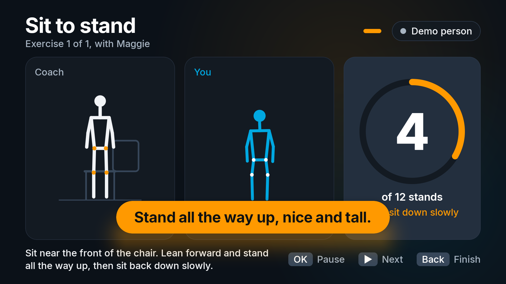
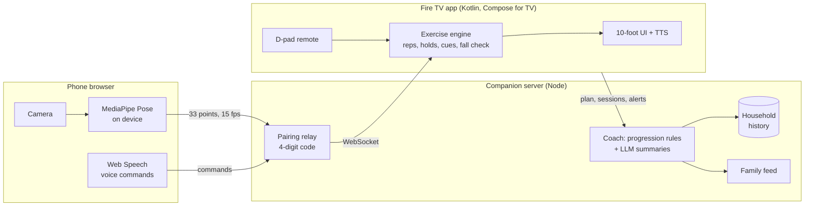

# Steady

**A strength-and-balance coach for Fire TV that helps older adults stay on their feet.**

Steady turns the TV into a patient exercise coach for fall prevention. Your phone, propped against a book, becomes the camera: it tracks your body on the phone itself and sends only 33 joint positions to the TV. The TV shows an animated coach next to a live mirror of you, counts reps, times balance holds, gives one plain-language cue at a time, and checks on you if you go down.

Built for the **Fire TV track** of the Build, Ship, Shape Amazon Developer Hackathon.



## Why

- **1 in 4 adults over 65 falls every year.** That's 14 million people, and falls are the leading cause of injury death in that age group ([CDC](https://www.cdc.gov/falls/data-research/index.html)).
- **The exercises work, but people stop doing them.** The Otago home exercise programme cuts falls by about a third. A year in, only about 37% of people are still doing it ([Age and Ageing review](https://researchnow.flinders.edu.au/en/publications/does-the-otago-exercise-programme-reduce-mortality-and-falls-in-o/)).
- **The problem is doing them alone, not knowing what to do.** People lack feedback, a sense of progress, and someone noticing.
- **The TV is the obvious place for this.** It's the largest, most familiar screen an older adult owns. Most Fire TVs have no camera, but almost everyone has a phone.

## What it does

| | |
|---|---|
| **Phone as camera** | Scan a QR code on the TV. Pose estimation (MediaPipe Pose Landmarker) runs **on the phone**; only joint points travel to the TV. Video never leaves the phone. |
| **Coach + mirror** | An animated coach demonstrates each move beside a mirrored skeleton of you, so "do what I do" works from the sofa. |
| **Counts and corrects** | Rep counting for sit-to-stand, heel raises, marching and side leg raises; a timer and steadiness score for one-leg balance; one form cue at a time ("Stand all the way up", "Lift your knees a little higher"), spoken and shown. |
| **Multi-modal control** | D-pad on the Fire TV remote (OK pauses, ▶ skips, Back finishes), voice on the phone ("pause", "easier", "next", "I'm OK"), big visuals on the TV, in one flow. |
| **Safety check** | If the body goes horizontal and stays there, the session stops, a full-screen "Are you OK?" appears, and after 15 seconds without an answer the family contact is alerted. "I'm OK" sends a follow-up. |
| **Clinically grounded progress** | The CDC STEADI 30-second chair stand test, scored against age and sex norms and repeated every two weeks. |
| **Adapts to the household** | Each person has a profile and history. The home screen predicts who's exercising from the household's own habits ("Walter usually exercises around 6:30 PM"). The plan progresses by Otago-style rules: more reps after the target is met twice, fewer after a miss. An AI coach explains the plan and writes the end-of-session summary. |
| **Family in the loop** | A family page (open it on a phone) receives session summaries and safety alerts as they happen. |

## How it works



- **`tv/`**: the Fire TV app. Kotlin with Jetpack Compose for TV (the same stack as Amazon's Fire TV starter sample), minSdk 25 (Fire OS 6+), Leanback launcher banner, D-pad and media-key handling, Android TextToSpeech, OkHttp WebSocket. The exercise engine (`pose/`) is pure Kotlin with JVM unit tests.
- **`companion/`**: Node + TypeScript. Pairs phone and TV by code, relays pose frames, serves the phone page and the family page, stores household history, and runs the coach. The LLM key stays on this server. Works without an LLM using rule-based text.
- **Demo person**: a synthetic person generated from the same keyframes as the coach animation (with natural jitter and the occasional sloppy rep), so the app runs with no camera at all. The unit tests use it too.

## Run it

### 1. Companion server

```bash
cd companion
npm install
npm start            # http://localhost:8787  (phones on the same Wi-Fi use the LAN address it prints)
```

Optional AI coach: create `.env` in the repo root (or `companion/`) with an OpenAI-compatible key. Groq's free tier works:

```
LLM_API_KEY=gsk_...
# LLM_BASE_URL=https://api.groq.com/openai/v1   (default)
# LLM_MODEL=openai/gpt-oss-120b                 (default)
```

### 2. Fire TV app

**Emulator** (Android TV API 30, the base of Fire OS 8). Android Studio, or the command line:

```bash
sdkmanager "system-images;android-30;android-tv;x86"
avdmanager create avd -n FireTV_API30 -k "system-images;android-30;android-tv;x86" -d tv_1080p
emulator -avd FireTV_API30 &
cd tv && ./gradlew installDebug
adb shell am start -n com.steady.tv/.MainActivity
```

The emulator reaches the companion at `http://10.0.2.2:8787` by default.

**Real Fire TV**: enable *Developer options → ADB debugging*, then:

```bash
adb connect <fire-tv-ip>
cd tv && ./gradlew installDebug
adb shell am start -n com.steady.tv/.MainActivity --es server http://<your-computer-ip>:8787
```

A prebuilt APK is attached to the GitHub release.

### 3. Phone

Scan the QR code on the TV (phone and computer on the same Wi-Fi), tap **Start camera**, and prop the phone 2 to 3 meters away so it sees you head to feet. Phone browsers only allow the camera on HTTPS or localhost, so for a phone on your LAN, run an HTTPS tunnel (for example `cloudflared tunnel --url http://localhost:8787`) and start the companion with `PUBLIC_URL=https://<tunnel-host>`. A laptop browser at `http://localhost:8787/p/<code>` works as the camera with no setup.

**No phone?** Choose **Demo person** on the TV. Press **Menu** during a demo session to act out a fall and see the safety flow.

**Family page**: open `http://localhost:8787/family`.

## Remote control

| Key | In a session |
|---|---|
| OK / Play-Pause | Pause or carry on; skip a countdown; answer "I'm OK" |
| ▶ / Fast-forward | Next exercise |
| Back | Finish the session (results are saved) |
| Menu | Demo person only: simulate a fall |

## Tests

```bash
cd tv && ./gradlew testDebugUnitTest      # exercise engine: reps, cues, holds, fall check, CDC norms
cd companion && npm test                  # progression rules, household prediction, pairing relay, sessions API
```

## Safety and scope

Steady is a coaching and screening aid, not a medical device. It never gives dosing or diagnostic advice, and it tells people to call 911 for chest pain, dizziness or faintness. The chair stand result is compared with published CDC STEADI norms and framed as something to share with a clinician.

## License

MIT for the code ([LICENSE](LICENSE)). Atkinson Hyperlegible font © Braille Institute of America, SIL Open Font License ([notices](THIRD_PARTY_NOTICES.md)).
